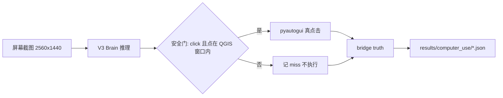

> 软件项目文档链 · 7 件套  
> 上游：[需求规格](docs/taskhub/c3ecabb0/requirement.md) | 下游：[模块 Spec](docs/taskhub/c3ecabb0/spec.md)  
> 约定：正文**分点 + 换行**（每点一行，`-` 列表）；指引注释处填内容，未用章节删除。

# 架构设计（Architecture Design）

## 文档信息

| 项 | 值 |
|---|---|
| 文档版本 | v0.1 |
| 最后更新 | 2026-10-03 19:40 |
| 状态 | approved |
| 负责人 | opencode |
| 适用范围 | 模型接环线整体（W28–W31）：闭环执行器、示范数据采集、微调评测、验证器闭环。不含：模型训练框架改造、QGIS 本身、云端部署 |

## 1. 系统上下文
- 调用方：实验脚本（`experiments/computer_use/loop_w28.py` 等）与后续 taskhub 任务（本链 W28–W31）。
- 本系统调用：
  - MioArgus v3 模型：本地 checkpoint `artifacts/checkpoints/computer_use_model_v3_real.pth`，GPU 推理。
  - QGIS 进程：真应用，pyautogui 真鼠标执行。
  - qgis_bridge：QGIS 进程内 PyQGIS 真值/特权通道（extent/scale/tool/renderer/文件产物）。
- 数据从哪来、到哪去：
  - 屏幕截图（2560×1440）→ 模型 → 动作+坐标 → 安全门 → 真点击 → bridge truth → 判定 → 结果 json / 文档。

## 2. 总体架构
- 模块划分：
  - Brain：v3 推理封装（图像预处理 / 指令编码 / 预测解析）。实现：`loop_w28.py::Brain`，模型定义 `mio/mio_argus.py`。
  - Executor：安全执行器（窗口矩形门 + 动作白名单 + 越界不点）。实现：`loop_w28.py::do_step`。
  - Testbed：QGIS 真应用 + 场景重置（bridge `reset/real`）+ 窗口可见性保障（`ensure_visible`）。
  - Truth：bridge `truth`（extent/scale/tool/renderer/图层信息）。
  - Recorder（W29 计划）：确定性链运行中的示范数据录制器（脚本动作即标签）。
  - Verifier（W31 计划）：结果验证器（复用 W5/W10 机械，对终局状态判定）。
- 每个模块的详细设计 → [模块 Spec](docs/taskhub/c3ecabb0/spec.md)。

## 3. 关键技术决策（ADR 摘要）
| 决策 | 备选 | 结论与理由 |
|------|------|-----------|
| 真应用选 QGIS | VM 合成桌面 | QGIS 有真值通道与 W1–W27 机械；VM 合成截图与训练数据同源，测不出真实域差距（W28 已用真 QGIS） |
| 安全门放执行器（前置） | 无门 / 后验撤销 | 零样本模型不可信（W28：全 scroll + 坐标≈原点）；前置门=零副作用，实测 0 越界点击 |
| 期望值用特权校准 | 单层 extent 直接比较 | W28 oracle 暴露：Zoom Full = 全图层并集 ≠ provinces 单层 extent；用桥 `act` 触发一次并读 extent/scale 作期望最稳 |
| 示范数据用脚本当老师 | 人工标注 / 遥操作 | 脚本自带动作与真值（零人工、可复现）；W23–W27 链已覆盖主窗/菜单/对话框 |
| 坐标反投影按屏幕尺寸 | 固定 1920×1080 | 模型输出 [0,1]²；训练帧 16:9，实机 2560×1440 同为 16:9，比例一致 |

## 4. 关键数据流
- 单步闭环（每步）：
  1. `ensure_visible(QGIS)`（Qt showMaximized 对最小化窗口静默无效 → 外部 `ShowWindow` 兜底）
  2. `pyautogui.screenshot()` 全屏截图
  3. `Brain.predict(img, instruction)` → `{action, coord[0,1]², scroll}`
  4. 安全门：`action==click` 且坐标落在 QGIS 主窗口矩形内才执行，否则记 `action_wrong` / `out_of_window`
  5. `pyautogui.click` → sleep 1 s → `bridge truth` → 判定（extent 1% span / scale 1% 相对容差）
- 存储点：
  - 逐条结果：`results/computer_use/w28_results.json`（W28）；后续 W29/W30/W31 同名规则。
  - 示范数据（W29）：`artifacts/computer_use_inloop/`（gitignored）。
  - checkpoint（W30）：`artifacts/checkpoints/`。
- 转换点：坐标 `coord × 屏幕尺寸`；指令为英文模板短句；失败分类学见 spec。

## 5. 技术选型
- 语言 / 框架：Python 3.12；torch + transformers（离线缓存）；pyautogui + pywinauto(UIA) + win32gui。
- 存储：json / npz 文件（无数据库）。
- 第三方依赖：QGIS 3.44（本机）+ qgis_bridge（同仓库、自包含、运行产物就地保存）。

## 6. 风险与对策
- 风险：
  - 域差距过大：W30 微调后仍 0% → kill 条件与升级路径见 plan。
  - 真鼠标误点：安全门（窗口矩形）+ 动作白名单；W28 实测 0 次越界点击。
  - QGIS 工程崩溃（关设计器后异步崩，W27 已见）→ `ensure_qgis()` 自动重启。
  - 窗口最小化幽灵句柄（-32000）→ 按"在屏内+面积最大"选窗口 + 外部恢复。
- 对策：
  - 每步真值判定 + 失败分类学（action_wrong / out_of_window / truth_fail / no_qgis_window / target_not_in_uia）。
  - oracle 通路自检先于模型闭环，确保机械本身可用（W28 发现期望值协议 bug 即为此设计的目的）。
